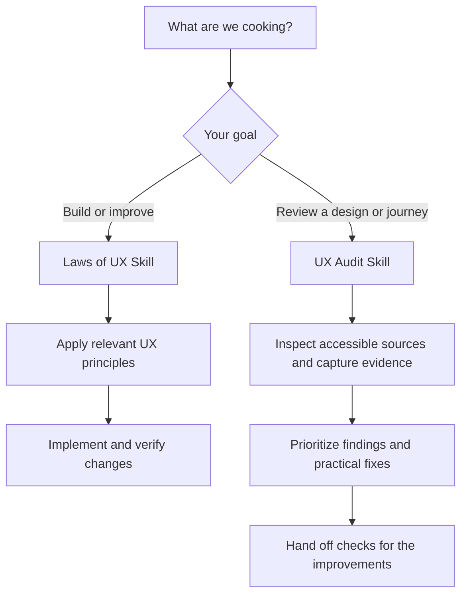

# 🍳 Cooking UX

**Good interfaces, fewer “wait… what?” moments.**

Give your AI a UX recipe book and a second pair of eyes. Because “the button is technically there” is a surprisingly low bar.

Cooking UX contains two portable skills: practical design guidance drawn from 30 [Laws of UX](https://lawsofux.com/) concepts, and a dedicated evidence-based UX Audit Skill for Figma, user flows, and live web pages.

Use them with Codex, Claude Code, other compatible coding agents, or an AI assistant that can read the included files. Choose design guidance for building/improving an interface, or the audit skill for a structured, prioritized review.

## 📋 Pick your recipe

| Skill | Use it for | Start here |
|---|---|---|
| `laws-of-ux-skill` | Design and implement better interfaces using relevant UX principles | [Guide](laws-of-ux-skill/README.md) |
| `ux-audit-skill` | Audit Figma designs, user flows, and live pages; report evidence, severity, priority, recommendations, and checks | [Audit guide](ux-audit-skill/README.md) |

### From “something feels off” to a useful next step



Building? Start with the design skill. Investigating friction? Start with the audit skill. They work independently; install either or both.

## 🧑‍🍳 What’s on the menu?

- Build clearer landing pages, dashboards, and application screens.
- Improve navigation, forms, tables, empty states, and user flows.
- Reduce unnecessary choices, confusion, and memory demands.
- Review an interface and prioritize actionable improvements.
- Refactor frontend components while preserving working behavior.
- Consider accessibility, responsive layouts, feedback, and error recovery.

Every Laws of UX concept includes an original explanation, practical applications, implementation guidance, good and bad examples, limitations, and a source link. Both skills can review supplied material offline. Live URLs and Figma files still need suitable tools and authorized access.

## 🚀 Install: apron on, one command

Run this in your project’s terminal:

```sh
npx skills add https://github.com/sharmadipesh/cooking-ux
```

Select `laws-of-ux-skill`, `ux-audit-skill`, or both, and your coding agent when prompted. The installer adds the complete skill folder, including its references and workflows. No manual clone or file copying is needed. It requires Node.js 22.20 or later and Git. This uses the third-party [open-source Skills CLI](https://github.com/vercel-labs/skills).

Install only the audit skill:

```sh
npx skills add https://github.com/sharmadipesh/cooking-ux --skill ux-audit-skill
```

Want the selected skill available across projects? Add `-g`:

```sh
npx skills add https://github.com/sharmadipesh/cooking-ux -g
```

## Prefer to paste one link?

Copy this message into an agent that supports repository access and skill installation:

> Install the UX skill from https://github.com/sharmadipesh/cooking-ux into this project for my coding agent. Install the complete laws-of-ux-skill folder, including its references and workflows. Preserve any existing installation and report the installation path.

For the dedicated audit skill, paste:

> Install the UX Audit Skill from https://github.com/sharmadipesh/cooking-ux into this project for my coding agent. Install the complete ux-audit-skill folder, including its references and templates. Preserve any existing installation and report the installation path.

A repository link alone cannot automatically install files in every AI product. Your agent needs installation tools and access to your project. For chat assistants without installation support, attach the [design ZIP](laws-of-ux-skill.zip) or [audit ZIP](ux-audit-skill.zip) and ask them to read SKILL.md and the relevant files.

## 💬 Tell your agent what to cook

After installation, start a new agent session if needed. In Codex, try:

> Use $laws-of-ux-skill to improve this dashboard. Reuse the existing design system, preserve its functionality, and make the most important information and actions easier to find. Implement the changes and report what you verified.

In Claude Code, use `/laws-of-ux-skill` instead. Automatic discovery depends on the product and its settings. See [the full guide](laws-of-ux-skill/README.md) for manual installation and offline usage.

For an audit in Codex:

> Use $ux-audit-skill to audit [Figma link, website URL, or attached flow] for [audience and task]. Cite screens/components/steps, separate observed issues from hypotheses, and prioritize practical improvements. Stop before real transactions or data changes.

Use `/ux-audit-skill` in Claude Code. See the [audit report template](ux-audit-skill/templates/audit-report.md), [example artifact review](ux-audit-skill/examples/artifact-audit.md), and [tested live sandbox report](ux-audit-skill/tests/results/live/report.md).

## 🥣 A taste of the output

**The problem:** a form rejects your email, then clears everything you typed. The interface has apparently chosen amnesia.

Here’s how an audit turns that frustration into work someone can actually pick up. This abbreviated example comes from the [tested local sandbox report](ux-audit-skill/tests/results/live/report.md), not a production site.

| A useful finding needs… | Example |
|---|---|
| A precise observation | After a 422 rejection, both fields become empty. |
| Evidence you can inspect | Report evidence E05, E09, E13 and E14; request → rejection → retry. |
| User impact | Users must re-enter information to correct an email-related error. Impact is inferred; abandonment was not measured. |
| Separate ratings | **Moderate severity · P1 priority · High confidence** in the clearing behavior. |
| A practical fix | Keep the email editable, associate the error with it, and handle password clearing according to the agreed policy. |
| A finish line | Retry by keyboard and on mobile; confirm email remains and only intended corrections are required. |

For implementation, a similarly focused request is:

> Use $laws-of-ux-skill to improve this form’s labels and error recovery. Reuse our components, preserve validation rules, and verify filled, rejected, and retry states on mobile and with a keyboard.

A useful recommendation has a location, a reason, and a way to check it. “Make it pop” can stay in the seasoning cupboard.

## 📚 Open the recipe book

| Start here | What you will find |
|---|---|
| [Skill instructions](laws-of-ux-skill/SKILL.md) | The decision process and reference routing |
| [Full usage guide](laws-of-ux-skill/README.md) | Installation, prompts, sharing, offline use, and updates |
| [30-concept inventory](laws-of-ux-skill/references/ux-laws-index.md) | Verified concepts and original source links |
| [Component playbook](laws-of-ux-skill/references/component-playbook.md) | Concrete states, decisions, and checks for common UI patterns |
| [Decision guidance](laws-of-ux-skill/references/decision-and-validation.md) | Evidence, competing principles, and claim-appropriate validation |
| [Workflows](laws-of-ux-skill/workflows/) | Design, audit, improvement, and implementation |
| [Examples](laws-of-ux-skill/examples/) | Practical decisions, an audit, and implementation guidance |
| [Validation report](laws-of-ux-skill/tests/validation-report.md) | Checks performed and their limitations |
| [Downloadable ZIP](laws-of-ux-skill.zip) | The complete portable skill package |
| [Changelog](CHANGELOG.md) | Skill versions and what changed |

## 🧪 Check the ingredients

The optional checks require Python 3.9+ and no third-party Python packages:

```sh
python3 -B laws-of-ux-skill/scripts/validate.py
python3 -B -m unittest discover -s laws-of-ux-skill/tests -p 'test_*.py' -v
python3 -B laws-of-ux-skill/scripts/package.py --check
```

The package includes seven design scenarios, two implemented sandbox interfaces, and 13 browser acceptance checks. See [optional browser setup](laws-of-ux-skill/tests/browser/README.md) and [implementation evidence](laws-of-ux-skill/tests/implementation-evaluation.md). Browser checks exercise contracts, states, keyboard paths, and three viewport widths. They do not establish production integration, user outcomes, or full accessibility conformance.

## Check the UX Audit Skill

```sh
python3 -B ux-audit-skill/scripts/validate.py
python3 -B -m unittest discover -s ux-audit-skill/tests -p 'test_*.py' -v
python3 -B ux-audit-skill/scripts/package.py --check
```

Download [ux-audit-skill.zip](ux-audit-skill.zip) for the standalone audit package. The skill includes acquisition guidance, a full audit coverage checklist, a severity/priority/confidence rubric, report template, examples, and independent evaluation artifacts. [Validation notes](ux-audit-skill/tests/validation-report.md) disclose which checks actually ran.

## 🤝 Credit where it’s due

This is an independent project informed by Jon Yablonski’s **Laws of UX**. It is not affiliated with or endorsed by Laws of UX. Source coverage was verified on October 27, 2026.

The package contains original explanations, workflows, and examples, with no copied article collection or artwork. The [MIT license](LICENSE) at the repository root, with a copy in each skill folder, covers original contributions only. Each SKILL.md declares its version; see the [changelog](CHANGELOG.md). Upstream website content has its own CC BY-NC-ND 4.0 license and is not relicensed here. See [source attribution and research scope](laws-of-ux-skill/references/source-links.md).
