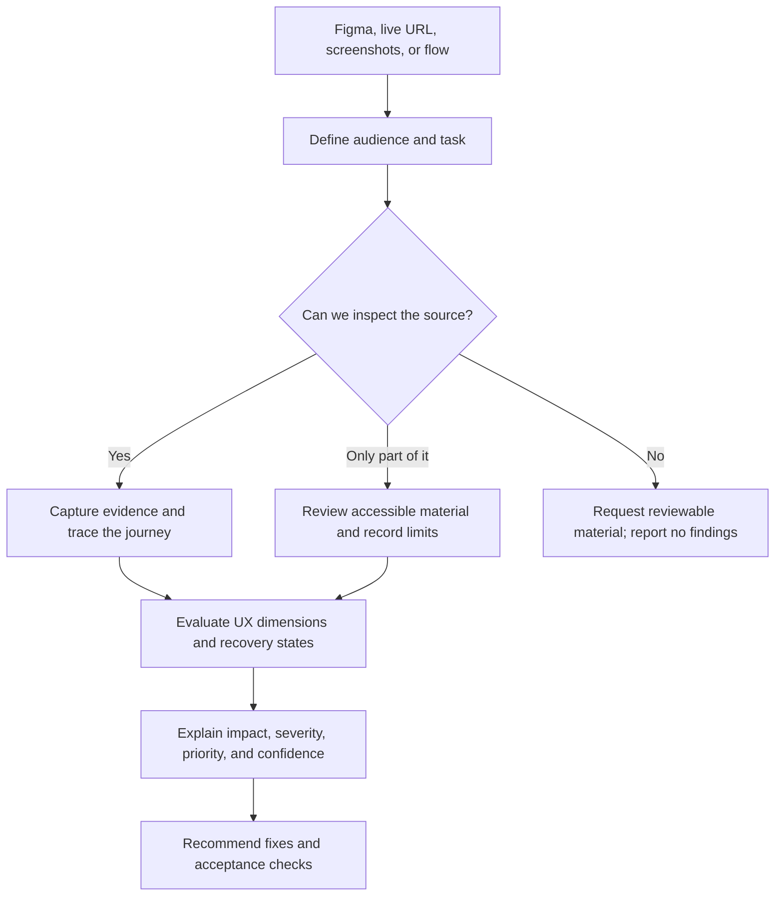

# 🔎 UX Audit Skill

**Find the friction. Explain the impact. Give the team a useful next step.**

Your interface may look delicious. Let’s check whether people can actually order lunch.

A dedicated, portable skill for auditing Figma designs, prototypes, user flows, screenshots, and live web pages. It produces a structured report with evidence, user impact, separate severity/priority/confidence, practical recommendations, and acceptance checks.

Read [SKILL.md](SKILL.md). It routes to source acquisition, audit dimensions, prioritization, and a copyable report template. It does not require the companion Laws of UX skill or a specific AI provider.

## 🚀 Install your UX inspector

```sh
npx skills add https://github.com/sharmadipesh/cooking-ux --skill ux-audit-skill
```

Select the target agent. Add `-g` for user-wide installation. The optional third-party Skills CLI requires Node.js 22.20+ and Git. Manual installation needs no Node packages: copy the whole `ux-audit-skill/` folder into your agent's documented directory.

| Local agent | Personal location | Project location | Invoke |
|---|---|---|---|
| Codex | `~/.agents/skills/ux-audit-skill/` | `.agents/skills/ux-audit-skill/` | `$ux-audit-skill` |
| Claude Code | `~/.claude/skills/ux-audit-skill/` | `.claude/skills/ux-audit-skill/` | `/ux-audit-skill` |

Preserve an existing installation rather than blindly overwriting it. Open a new session if discovery does not refresh. Other agents control their own directory/invocation conventions. A general assistant can use the full folder/ZIP as context, or SKILL.md plus the references it requests. A link alone does not grant filesystem access or install a skill in every product.

## 🗺️ How the audit works



In plain English: inspect what’s available, show what supports each finding, and explain what the team should do next. A locked Figma link is an access limit, not evidence that the design is terrible.

## 💬 Three orders you can place

### 1. Figma: “Does this journey make sense?”

> Use $ux-audit-skill to audit this Figma design: [link]. Review the account-setup journey for first-time coordinators. Prioritize issues by user impact, cite frames/nodes, and distinguish design findings from runtime behavior you cannot verify.

### 2. Live website: “Where do people get stuck?”

> Use $ux-audit-skill to audit [URL] for finding and booking a service. Inspect relevant mobile, tablet, and desktop states and keyboard paths. Stop before real booking/payment submission. Give an evidence-based report with severity, priority, recommendations, and checks for the fixes.

### 3. User flow: “What happens after this arrow?”

> Use $ux-audit-skill to review this supplied onboarding flow. Identify decision, handoff, navigation, recovery, and completion risks. Distinguish missing documentation from observed product defects and specify what to validate.

For Claude Code, replace the dollar invocation with `/ux-audit-skill`. Do not paste sensitive account data into prompts or reports.

## 🥣 Worked example: the form with a goldfish memory

**Situation:** a coordinator enters an email and password, submits an access request, and receives “Use a different email address.” Both inputs are now empty. Time to type everything again. Lovely.

This is a shortened finding from our [actual local sandbox audit](https://github.com/sharmadipesh/cooking-ux/blob/main/evaluation/ux-audit-skill/results/live/report.md). It demonstrates the reporting format; it is not a claim about a real product or a fix that has already shipped.

### UX-01 — Rejection erases correction context

| Part of the finding | What the report says |
|---|---|
| **Location** | Access-request form, rejection → correction → retry. |
| **Evidence** | E05, E09, E13 and E14 in the full report: both input lengths are zero after a 422 response, reproduced on desktop, mobile, and keyboard retry. |
| **Impact** | Users must re-enter information even though the message concerns email. Extra effort is inferred; abandonment and conversion effects were not measured. |
| **Severity: Moderate** | Recovery is possible, but requires avoidable re-entry. |
| **Priority: P1** | Address in the next meaningful improvement cycle: directly reproducible recovery friction. Engineering effort is unknown. |
| **Confidence: High** | Clearing is directly observed; the predicted user impact still needs validation. |
| **Recommendation** | Retain the editable email and associate its error. Decide password clearing with product/security requirements; explain clearing if required, and never persist passwords to storage. |
| **Improved pattern** | Field-level server validation with retained permissible input. |
| **Acceptance check** | Submit a rejected address on desktop/mobile and by keyboard. Confirm the email remains editable, its error is identifiable, and retry only needs intended corrections. Verify password behavior against the agreed policy. |

**The proposed experience:**

| Before | After the recommendation is implemented and verified |
|---|---|
| Error appears; both fields are wiped. | Email stays visible and editable; password handling follows the agreed policy. |
| The user reconstructs their attempt. | The user corrects the relevant field with its error in context. |
| “Did I type that wrong?” | “I can see what to change.” |

The full report also identifies missing error notification semantics and narrow-screen overflow. These are separate findings with their own evidence and checks; fixing input clearing alone does not resolve them.

## 📦 What lands on your desk?

A report organized for decisions and implementation:

1. **Executive assessment:** the most consequential issues and strengths worth keeping.
2. **Scope and evidence:** sources, screens/components, states, viewports, and access limits.
3. **Journey and coverage:** what was inspected, partially inspected, or not assessed.
4. **Prioritized findings:** observation → user impact → severity/priority/confidence → fix → acceptance check.
5. **Improvement sequence:** what to address first, dependencies, and validation gaps.

Coverage includes usability, accessibility, visual hierarchy, consistency, navigation, journeys, interactions, responsive behavior, friction, recovery, and trust. Each dimension gets an honest coverage status; an inaccessible state does not get a fictional review.

Want to see the full plate? Open the [report template](templates/audit-report.md), [supplied-artifact example](examples/artifact-audit.md), or [tested live sandbox report](https://github.com/sharmadipesh/cooking-ux/blob/main/evaluation/ux-audit-skill/results/live/report.md).

## 🎚️ Three ratings, three different questions

| Rating | Question it answers | Example above |
|---|---|---|
| **Severity** | How serious is the consequence if this happens? | Moderate: recoverable extra work. |
| **Priority** | What should the team do, and when? | P1: address in the next improvement cycle. |
| **Confidence** | How strong is the supporting evidence? | High for the observed clearing behavior. |

See the [complete rubric](references/severity-and-priority.md). No mystery “UX score: 73/100,” invented conversion lift, or Critical rating because someone dislikes a shade of blue.

## 🔐 Access and output

Figma and live-site audits require appropriate access plus host-provided reading/browser tools. This package supplies instructions, not those capabilities. If direct access fails, the agent should report that limit and review accessible exports or supplied artifacts. It must not pretend a static frame establishes DOM semantics, keyboard behavior, or production responsiveness.

Default output is a readable audit in the conversation. Request a Markdown file and evidence attachments if desired. [The template](templates/audit-report.md) defines the handoff format. [The example](examples/artifact-audit.md) demonstrates a limited artifact review. Audit permission does not authorize editing the design, commenting in Figma, publishing, or submitting real transactions.

## 🧪 Check the recipe, share the whole folder

Optional maintenance checks use Python 3.9+ and its standard library:

```sh
python3 -B ux-audit-skill/scripts/validate.py
python3 -B -m unittest discover -s ux-audit-skill/tests -p 'test_*.py' -v
python3 -B ux-audit-skill/scripts/package.py --check
```

From the repository parent, rebuild the sibling ZIP with `python3 -B ux-audit-skill/scripts/package.py` after changes, and bump `metadata.version` in SKILL.md when package content changes. Share the whole folder or `ux-audit-skill.zip`, including LICENSE, references, and templates. The optional structured JSON report can be checked with `scripts/validate.py --report path/to/report.json`; it verifies structure and evidence references, not whether observations are true or recommendations are good. Markdown remains the normal deliverable.

See [scenarios](tests/scenarios.md) and [validation evidence](tests/validation-report.md) for real checks and limits. The evaluated reports, screenshots, and loopback fixture server live in the repository’s [evaluation folder](https://github.com/sharmadipesh/cooking-ux/tree/main/evaluation/ux-audit-skill), not in the installed package. Synthetic fixtures do not establish authenticated Figma integration, production acceptance, or full accessibility conformance.

## 🤝 Sources and license

Original contributions are MIT licensed; see [LICENSE](LICENSE). Standards/articles remain with their respective owners. [Source notes](references/sources.md) explain provenance and the package-specific prioritization rubric. No external articles or Figma artwork are bundled, and no endorsement is asserted.
